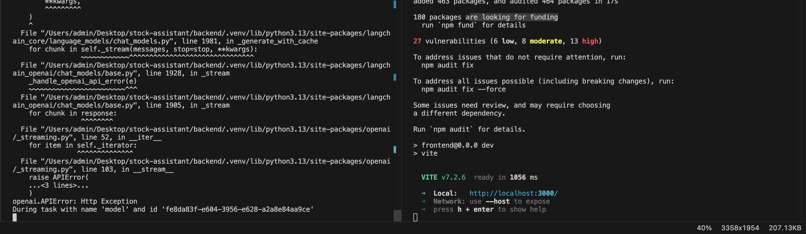

# AI Stock Analysis Assistant

A chat assistant that analyses stocks with live market data and answers with generated interface components (charts, tables, cards) instead of plain text. Built by following NeuralNine's tutorial [Advanced AI Stock Analysis Assistant in Python](https://www.youtube.com/watch?v=AE_6F8cuXsA) as homework for the Latest Trends in Data Science (LTDS) course at Modul University Vienna, Financial Services & Insurance session.

## Status

The backend, frontend and agent tools are complete, and both servers run locally. The model call to Thesys C1 is blocked: on a free account with no credits, every request returns:

```
Error code: 429 - {'error': {'message': 'The organization has insufficient balance.', 'type': 'rate_limit_error'}}
```



I confirmed this is an account balance issue, not a code or configuration issue:


- The API key is loaded correctly from `backend/.env` (checked without printing the key).
- Calling the Thesys API directly with the OpenAI client, bypassing LangChain, returns the same 429 error for two different models (`c1/openai/gpt-5/v-20251230` and `c1/anthropic/claude-sonnet-4/v-20251230`).

Generative UI responses can therefore not be demonstrated without buying Thesys credits or connecting a provider key through Thesys's BYOK option.

## How it works

```
Browser: React + C1Chat (port 3000)
   |  user question
   v
FastAPI backend (port 8888)
   |  LangChain agent loop
   v
Thesys C1 model  <-->  tools (yfinance: Yahoo Finance data)
   |  response describes UI components
   v
C1Chat renders them as charts, tables and cards
```

1. The React frontend sends the user's message to `POST /api/chat` (Vite proxies `/api` to the backend).
2. The FastAPI backend passes it to a LangChain agent (`create_agent`) with an in-memory checkpointer, so each chat thread keeps its history.
3. The agent's model is Thesys C1, an OpenAI-compatible API that returns UI component descriptions instead of plain text.
4. When it needs data, the model calls one of four tools, which fetch it from Yahoo Finance via `yfinance`:

| Tool | Returns |
| --- | --- |
| `get_stock_price` | Latest closing price for a ticker |
| `get_historical_stock_price` | Price history between a start and end date |
| `get_balance_sheet` | The company's balance sheet |
| `get_stock_news` | Recent news for the ticker |

5. The response streams back to the browser, where Thesys's `C1Chat` component renders it as interactive UI.

This is the same observe, decide, act loop as the agents covered in the course: the model chooses a tool, the harness (LangChain) runs it and feeds the result back, until the model gives a final answer.

## Tech stack

| Layer | Tools |
| --- | --- |
| Backend | Python, FastAPI, Uvicorn, LangChain + LangGraph, yfinance, python-dotenv |
| Model | Thesys C1 generative UI API (OpenAI-compatible) |
| Frontend | React 19, TypeScript, Vite, `@thesysai/genui-sdk`, `@crayonai/react-ui` |

## Setup

**Prerequisites:** Python 3.12+, Node.js 20+, and a Thesys API key from [console.thesys.dev](https://console.thesys.dev) with credits or a BYOK provider configured.

**Backend** (terminal 1):

```bash
cd backend
python3 -m venv .venv
source .venv/bin/activate
pip install fastapi "langchain[openai]" pydantic python-dotenv uvicorn yfinance
```

Create `backend/.env`. LangChain's `ChatOpenAI` reads `OPENAI_API_KEY`, so the Thesys key goes under that name:

```
OPENAI_API_KEY=your-thesys-key
```

Start it:

```bash
python main.py
```

**Frontend** (terminal 2):

```bash
cd frontend
npm install
npm run dev
```

Open http://localhost:3000 and ask, for example, "Show me Apple's stock price over the last 6 months".


## Changes from the tutorial

- Updated the model from `c1/openai/gpt-5/v-20250930` to `c1/openai/gpt-5/v-20251230`, since Thesys versions its models and the original is from 2025.
- Installed dependencies with `pip` and a virtual environment instead of `uv`.
- Added a `.gitignore` so the API key (`.env`), virtual environment and `node_modules` are never committed.

## Limitations

- Requires a paid or BYOK Thesys account for model calls (see Status).
- `get_balance_sheet` and `get_historical_stock_price` return pandas objects; very large date ranges may produce long tool outputs.
- Chat history lives in memory and is lost when the backend restarts.
- Not financial advice: this is a programming exercise.

## Credits

Code based on the [NeuralNine youtube-tutorials repository](https://github.com/NeuralNine/youtube-tutorials/tree/main/AI%20Stock%20Analysis%20Assistant).